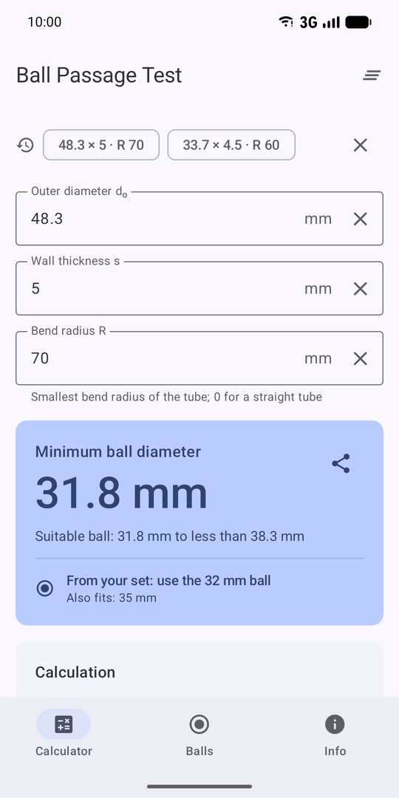
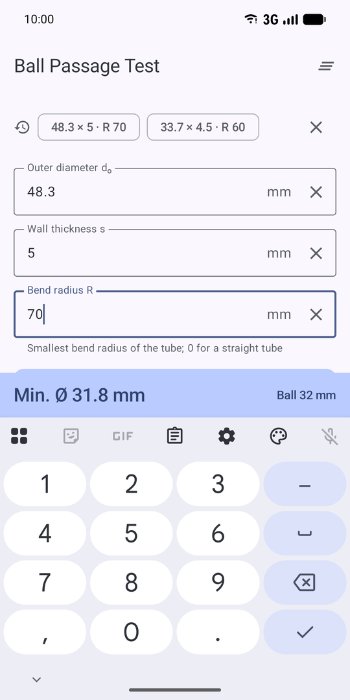
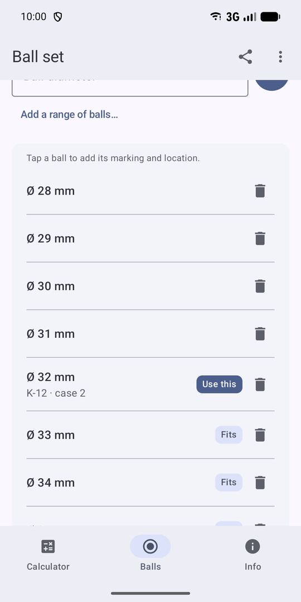
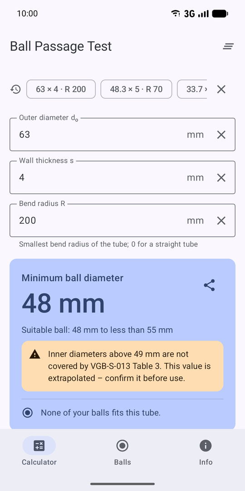
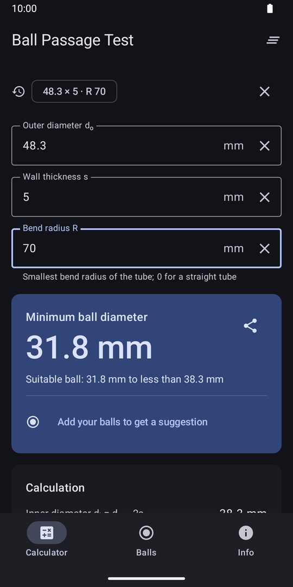

# Ball Passage Test

Android app that calculates the steel ball diameter for the **ball passage test**
(ball test, *Kugeldurchlaufversuch*, *kulowanie*) of bent tubes according to
**VGB-S-013-00-2014-12, section 7.2.5, Table 3**.

<p>
  
  
  
  
  
</p>

## Features

- **Calculator.** Results update as you type. While the keyboard is open, a compact result bar
  replaces the navigation bar, so the result stays visible on small phones. The screen also
  shows the step-by-step calculation and Table 3 with the cell that was used highlighted.
  When a tube is outside the table, the app says why, for example the minimum bend radius.
- **Ball sets.** Keep the steel balls of each workshop or case as a separate set and switch the
  active one. You can add balls one by one or as a range (e.g. 20–50 mm every 1 mm), and give
  each ball a marking and location (e.g. *K-12 · case 2*). The calculator recommends the smallest
  ball of the active set that fits, together with its marking. The Balls tab marks the balls
  that fit the tube currently in the calculator.
- **Sharing ball sets.** A set can be shared as a QR code that you scan in the app on another
  phone, or as text that you send by message or e-mail and paste on import. Scanning runs
  fully on the device (CameraX + ZXing, no Google services). The camera permission is requested
  only when the scanner opens.
- **Recent tubes.** The last 8 tubes are kept and can be recalculated with one tap. A tube is
  saved only after its input has stayed unchanged for 2 s.
- **Share.** Sends a plain-text summary for protocols and messages.
- **Info.** Standard, method, disclaimer, privacy and app version.
- **Languages.** English, Polish and German. The app name is localized as well: *Ball Passage
  Test*, *Przelot kulki* (PL) and *Kugeldurchlauf* (DE). Library resources are limited to these
  three languages, so the UI is never mixed. Under the launcher icon the English name is
  shortened to *Ball Passage*, so that it is not cut off.

## Calculation

| Input | Symbol |
|---|---|
| Outer diameter | dₒ |
| Wall thickness | s |
| Smallest bend radius of the tube (0 = straight tube) | R |

1. Inner diameter: `dᵢ = dₒ − 2s`
2. Row: `dᵢ` rounded to whole millimetres (half up), 20–57 mm.
3. Column: bend ratio `R / dₒ`, ranges `[0.5, 1.0)`, `[1.0, 1.5)`, `[1.5, 2.0)`, `[2.0, ∞)`.
   A straight tube (R = 0) uses the last column.
4. Minimum ball diameter: `dᵢ − deduction`. The ball may be smaller than `dᵢ` by at most the
   deduction, so a ball with `dᵢ − deduction ≤ d < dᵢ` is suitable.

| dᵢ [mm] \ R/dₒ | 0.5–1.0 | 1.0–1.5 | 1.5–2.0 | ≥ 2.0 |
|---|---|---|---|---|
| 20–29 | 6 | 5.5 | 5 | 4 |
| 30–39 | 7 | 6.5 | 6 | 5 |
| 40–49 | 8 | 7.5 | 7 | 6 |
| 50–57 * | 9 | 8.5 | 8 | 7 |

\* Not part of the standard. Extrapolated values; the app always marks them as outside the standard.

All arithmetic uses `BigDecimal`, and the column bounds are compared as `R ≥ bound · dₒ`.
This means values exactly on a bound (e.g. R/dₒ = 1.0) are never misclassified by
floating-point rounding.

This app replaces the earlier *Kulowanie* web app (React PWA) and keeps its calculation
rules. Changes from the old app: the analytics are removed, an inverted validation
message is fixed, and the extrapolated row is marked.

## Project structure

| Module | Contents |
|---|---|
| `:core` | Pure Kotlin calculation (`BallPassageCalculator`, `BallPassageTable`), ball sets (`BallSets`, `BallRange`), sharing format (`BallSetCodec`) and ball selection (`BallSelector`), no Android dependencies |
| `:app` | Jetpack Compose UI (Material 3) with three tabs, ViewModels, DataStore persistence (`UserDataRepository`), resources in EN / PL / DE |

Tech: Kotlin, Jetpack Compose, Material 3 (dynamic color, dark theme), DataStore, AGP 9,
minSdk 26, targetSdk 36. No network permission, no analytics, no third-party SDKs. Android
backup includes only the DataStore file, which holds the ball set and recent tubes.

## Building

Requirements: JDK 17+ and the Android SDK. Missing SDK platforms are downloaded by Gradle on the first build.

```sh
./gradlew check            # unit tests (core + app, incl. Robolectric UI tests) and lint
./gradlew connectedDebugAndroidTest  # instrumented tests (dialog flows) on a device or emulator
./gradlew assembleDebug    # debug APK
./gradlew bundleRelease    # release App Bundle (R8 minified)
```

Lint warnings fail the build, and so do Kotlin warnings in the app module.

Instrumented tests (`app/src/androidTest`) cover the dialogs of the Balls tab. They run on a
device because Robolectric never gets idle after typing into text fields inside Compose
dialogs. Real devices render those dialogs normally, which was checked by counting frames.

## Release signing

Release builds are signed with the **upload key** when it is configured. Otherwise they are
built unsigned. Google Play App Signing holds the app signing key.

Local builds read `keystore.properties` in the project root. This file is git-ignored:

```properties
storeFile=/absolute/path/to/upload.jks
storePassword=...
keyAlias=upload
keyPassword=...
```

CI (`.github/workflows/release.yml`) builds a signed bundle when a `v*` tag is pushed and
attaches it to a GitHub release together with the R8 mapping file. It needs these repository
secrets: `UPLOAD_KEYSTORE_BASE64`, `UPLOAD_KEYSTORE_PASSWORD`, `UPLOAD_KEY_ALIAS` and
`UPLOAD_KEY_PASSWORD`.

To create the upload key:

```sh
keytool -genkeypair -v -keystore upload.jks -alias upload -keyalg RSA -keysize 4096 -validity 10000
base64 -w0 upload.jks   # value for UPLOAD_KEYSTORE_BASE64
```

## Store listing

The `fastlane/metadata/android/` folder holds the Google Play listing in EN, PL and DE:
titles, short and full descriptions, changelogs, the 512 px icon, the feature graphic and
phone screenshots. The folder layout follows the
[fastlane supply](https://docs.fastlane.tools/actions/supply/) format, so you can upload it
by hand or with `fastlane supply`. The privacy policy is in [PRIVACY.md](PRIVACY.md).

## Releasing a new version

1. Bump `versionCode` and `versionName` in `app/build.gradle.kts`.
2. Add `fastlane/metadata/android/<locale>/changelogs/<versionCode>.txt`.
3. Tag and push, for example `git tag v1.0.1 && git push --tags`.

## License

Copyright © 2026 Łukasz Stalmasiński. **All rights reserved.**

The source code is public for reference only. It may not be copied, modified, distributed or
used in other projects without written permission. See [LICENSE](LICENSE).
