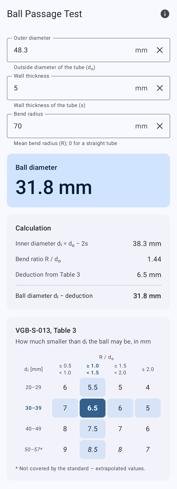
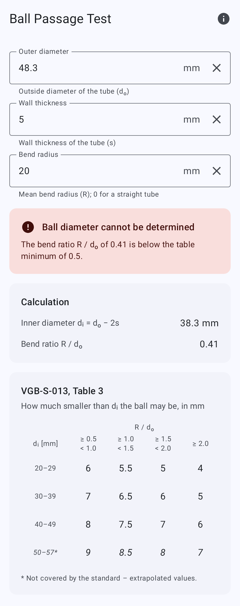
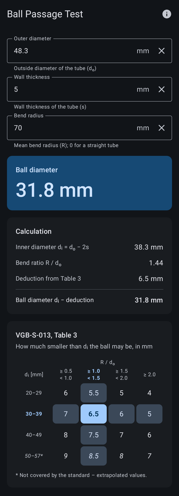

# Ball Passage Test

Android app that calculates the steel ball diameter for the **ball passage test**
(ball test, *Kugeldurchlaufversuch*, *kulowanie*) of bent tubes according to
**VGB-S-013-00-2014-12, section 7.2.5, Table 3**.

<p>
  
  
  
  
</p>

## Calculation

| Input | Symbol |
|---|---|
| Outer diameter | dₒ |
| Wall thickness | s |
| Mean bend radius (0 = straight tube) | R |

1. Inner diameter: `dᵢ = dₒ − 2s`
2. Row: `dᵢ` rounded to whole millimetres (half up), 20–57 mm.
3. Column: bend ratio `R / dₒ`, ranges `[0.5, 1.0)`, `[1.0, 1.5)`, `[1.5, 2.0)`, `[2.0, ∞)`.
   A straight tube (R = 0) uses the last column.
4. Ball diameter: `dᵢ − deduction`

| dᵢ [mm] \ R/dₒ | 0.5–1.0 | 1.0–1.5 | 1.5–2.0 | ≥ 2.0 |
|---|---|---|---|---|
| 20–29 | 6 | 5.5 | 5 | 4 |
| 30–39 | 7 | 6.5 | 6 | 5 |
| 40–49 | 8 | 7.5 | 7 | 6 |
| 50–57 * | 9 | 8.5 | 8 | 7 |

\* Not part of the standard. Extrapolated values; the app always marks them as outside the standard.

All arithmetic uses `BigDecimal`, and the column bounds are compared as `R ≥ bound · dₒ`.
This means values exactly on a bound (e.g. R/dₒ = 1.0) are never misclassified by
floating-point rounding.

This app replaces the earlier *Kulowanie* web app (React PWA) and keeps its calculation
rules. Changes from the old app: the analytics are removed, an inverted validation
message is fixed, and the extrapolated row is marked.

## Project structure

| Module | Contents |
|---|---|
| `:core` | Pure Kotlin calculation (`BallPassageCalculator`, `BallPassageTable`), no Android dependencies |
| `:app` | Jetpack Compose UI (Material 3), `CalculatorViewModel`, resources in EN / PL / DE |

Tech: Kotlin, Jetpack Compose, Material 3 (dynamic color, dark theme), AGP 9, minSdk 26,
targetSdk 36. No network permission, no analytics, no third-party SDKs.

## Building

Requirements: JDK 17+ and the Android SDK. Missing SDK platforms are downloaded by Gradle on the first build.

```sh
./gradlew check            # unit tests (core + app, incl. Robolectric UI tests) and lint
./gradlew assembleDebug    # debug APK
./gradlew bundleRelease    # release App Bundle (R8 minified)
```

Lint warnings fail the build, and so do Kotlin warnings in the app module.

## Release signing

Release builds are signed with the **upload key** when it is configured. Otherwise they are
built unsigned. Google Play App Signing holds the app signing key.

Local builds read `keystore.properties` in the project root. This file is git-ignored:

```properties
storeFile=/absolute/path/to/upload.jks
storePassword=...
keyAlias=upload
keyPassword=...
```

CI (`.github/workflows/release.yml`) builds a signed bundle when a `v*` tag is pushed and
attaches it to a GitHub release together with the R8 mapping file. It needs these repository
secrets: `UPLOAD_KEYSTORE_BASE64`, `UPLOAD_KEYSTORE_PASSWORD`, `UPLOAD_KEY_ALIAS` and
`UPLOAD_KEY_PASSWORD`.

To create the upload key:

```sh
keytool -genkeypair -v -keystore upload.jks -alias upload -keyalg RSA -keysize 4096 -validity 10000
base64 -w0 upload.jks   # value for UPLOAD_KEYSTORE_BASE64
```

## Store listing

The `fastlane/metadata/android/` folder holds the Google Play listing in EN, PL and DE:
titles, short and full descriptions, changelogs, the 512 px icon, the feature graphic and
phone screenshots. The folder layout follows the
[fastlane supply](https://docs.fastlane.tools/actions/supply/) format, so you can upload it
by hand or with `fastlane supply`. The privacy policy is in [PRIVACY.md](PRIVACY.md).

## Releasing a new version

1. Bump `versionCode` and `versionName` in `app/build.gradle.kts`.
2. Add `fastlane/metadata/android/<locale>/changelogs/<versionCode>.txt`.
3. Tag and push, for example `git tag v1.0.1 && git push --tags`.
